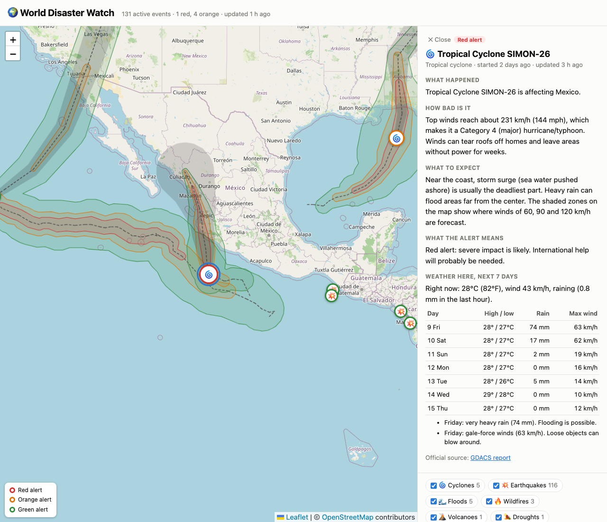

# World Disaster Watch

A live map of active disasters worldwide (tropical cyclones, earthquakes, floods, wildfires,
volcanoes and droughts) with each event explained in plain language and a 7-day weather
forecast for the affected spot.

**Live:** https://gopivardhan1965.github.io/world-disaster-watch/



## How it works

```
GDACS (UN / European Commission) ─┐                        ┌─ docs/data/events.json
                                   ├─► pipeline/fetch.py ──┤
USGS earthquakes (M4.5+, 7 days) ──┘   + explain.py        ├─ docs/data/cyclones.geojson
                                                           └─ data/history.csv (one row per day)
                                                                     │
                       docs/index.html (Leaflet map) ◄───────────────┘
                                 ▲
                                 └── Open-Meteo forecast, fetched in the browser on click
```

- **Hourly refresh.** A GitHub Actions workflow fetches every current GDACS event and the last
  7 days of USGS earthquakes, then redeploys the static site. USGS quakes are joined to GDACS
  impact alerts by event ID. If every feed comes back nearly empty, the run fails instead of
  publishing an empty map.
- **Plain-language explanations.** `pipeline/explain.py` turns the official numbers into
  sentences, so nothing is made up: magnitude and depth into "Strong: it can seriously damage
  buildings…", wind speed into a hurricane category and what those winds do, burned hectares
  into acres and soccer fields, drought area into square miles, and alert levels into what
  they mean.
- **Daily history.** The first run each day appends counts by alert level and hazard type to
  `data/history.csv`, building a running record of world disaster activity.
- **Forecasts come from official sources:** GDACS/NOAA cyclone wind zones (60/90/120 km/h)
  and tracks, and the Open-Meteo weather forecast at the event location, with plain notes for
  heavy rain, gale-force wind and dangerous heat. The app does not make its own disaster
  predictions.

## Run locally

Standard library only, Python 3.10+:

```bash
python pipeline/test_explain.py
python pipeline/fetch.py
python -m http.server -d docs               # http://localhost:8000
```

Not an official warning service. Always follow local authorities.
Data: GDACS, USGS, Open-Meteo; map © OpenStreetMap contributors.
